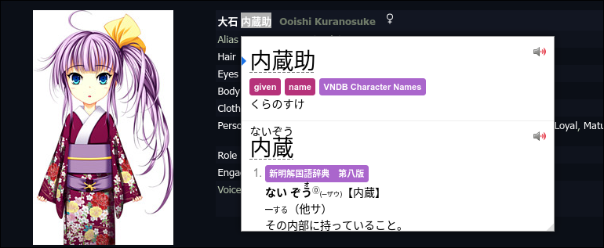

# VNDB Character Names



I made this dictionary so that anyone learning Japanese through visual novels can check how a
character's name is read on the fly, without pausing to search VNDB or look up name readings
elsewhere. Character names are one of the most common things to get stuck on: many are read in
unusual ways, games often show furigana only the first time a name appears, and general
dictionaries either don't have the name or list a dozen possible readings. With this
dictionary, looking up a name while you read shows its reading right in the popup, so you can
keep going.

It works for any game that has a VNDB page with its characters correctly listed. If a game is
too niche to be on VNDB, or its character entries are missing or wrong, its names won't be
found or may be wrong. See [Reporting a wrong or missing reading](#reporting-a-wrong-or-missing-reading)
for how to fix that.

The dictionary is built from the [VNDB](https://vndb.org) database. Each entry is one part of a
name, the family name or the given name, written in kanji, with its reading in hiragana.

- **43,668 readings** for **39,084 kanji spellings**
- Built from the VNDB database dump of **2026-11-18**
- Works in [Yomitan](https://github.com/yomidevs/yomitan) and other programs that read Yomitan
  dictionaries

## What it looks like

Entries follow the same layout as JMnedict: the headword is the kanji, and the reading is shown
as the definition. A spelling with more than one reading gets one block per reading, with the
reading used by the most characters first.

```
優希
  ゆうき

優希
  ゆき
```

Each entry is tagged `family`, `given` or `name` (a single name or part of a longer one),
depending on how VNDB lists it.

**Names are split into their parts.** 大石蔵之介 becomes two entries, 大石 and 蔵之介, so names
are found in any combination. Full names aren't included.

**Kana-only names are left out.** Anything containing at least one kanji stays, so お初 is in.
Names that are only kana can be read without a dictionary.

**There are no descriptions.** The dictionary contains readings only, with no character
information and no spoilers.

## Installing

1. Download [`VNDB Character Names.zip`](VNDB%20Character%20Names.zip?raw=true).
2. In Yomitan, open **Settings → Dictionaries → Configure installed and enabled dictionaries →
   Import**, and pick the zip. Don't unzip it.

Kana in a name won't bring up these entries, because the reading field is empty, as in
JMnedict. Look up the kanji.

## How it was made

Japanese names on VNDB come with a romanization, such as 大石 蔵之介 / Ooishi Kuranosuke. The
build turns those into kanji–kana pairs:

1. **Split** each name into family and given name using VNDB's romaji. Romaji in Western order
   is detected and swapped. Names without spaces are cut where the parts best match known names.
2. **Find the reading.** If [JMnedict](https://www.edrdg.org/enamdict/enamdict_doc.html) lists a
   reading for the spelling that matches the romaji, that reading is used. Otherwise the romaji
   is converted to kana, but only if the conversion is unambiguous.
3. **Settle ambiguous romaji.** Romaji doesn't show some spellings: *zu* can be ず or づ, *ji*
   can be じ or ぢ, and *o* can stand for お, おう or おお. JMnedict is checked first. If it
   doesn't settle the reading, the reading is judged from the kanji (for example づ when the
   sound comes from 月, 鶴 or 津), and then checked against web sources.
4. **Merge duplicates.** The same spelling with the same reading appears once, however many
   characters use it.

Where JMnedict does list a reading that matches, plain romaji conversion gives the same kana
98.1% of the time.

## How it was checked

After the automatic build, entries were audited in several passes:

- **Readings that don't fit the kanji.** Every reading that couldn't be matched against the
  kanji's known readings ([KANJIDIC2](https://www.edrdg.org/wiki/index.php/KANJIDIC_Project))
  was read one by one. 735 were removed. These were mostly mistyped romaji (椿 = すばき),
  readings that belong to a different character's name, and English words romanized as if they
  were Japanese (男爵 = ばろん).
- **ず/づ and じ/ぢ.** 371 entries were settled by reading the kanji of each name.
- **Ambiguous given names.** 34 names were settled using
  [pon-navi](https://pon-navi.net/nazuke/) name listings and the kanji's readings.
- **Uncommon readings.** 1,360 readings that matched no known reading of the name were checked
  against the kana printed next to the character's name on the game's
  [Getchu](https://www.getchu.com/) page. 291 were confirmed, and 25 were wrong and have been
  corrected for the characters concerned.
- **Ordinary words.** A single name that is also an ordinary Japanese word (such as 先輩 or 店長)
  is probably a title or a role, not a name. All 958 such entries were reviewed one by one. 155 that
  are really names were kept, and 228 were left out.
- **Aliases.** Names from VNDB's alias lists were added only when they're plain kanji names.
  Nicknames were reviewed and the doubtful ones removed.
About 2,170 spellings were left out because their reading couldn't be confirmed. Examples are
honorifics like 〜様, romaji that doesn't clearly give one reading, and kana in the name that
doesn't match the romaji. Another 6,979 characters couldn't be used at all, mostly because VNDB
has no romaji for them or the romaji doesn't line up with the kanji.

## Errors in VNDB itself

The audits above check readings, but they trust the names themselves as VNDB writes them. VNDB
is edited by its users, so its entries can be wrong, and those mistakes end up in this
dictionary.

One has already turned up. While reading a game, I noticed that a character the game calls
楡井田 (にれいだ) is listed on VNDB as 愉井田, with 愉 instead of 楡. That name is now
corrected in the build. Other misspelled kanji or wrong romanizations will still be in here.

## Reporting a wrong or missing reading

**First check the reading against the game.** The game's own furigana or name display is the
authority, not this dictionary. If the two disagree, look up the character on
[VNDB](https://vndb.org) to see where the mistake is:

- **VNDB is wrong or incomplete:** fix it on VNDB, not here. Edit the character's entry if the
  kanji or romaji is wrong or missing, or add the character if it isn't there. The next update
  of this dictionary picks up the change.
- **VNDB is right but the dictionary is wrong:** open an issue here with the name as the game
  writes it, the reading the game uses and the game's title. This also covers a name that's
  correct on VNDB but missing from the dictionary.

## Updates

I'll try to rebuild this dictionary from the newest VNDB dump about once a month, bringing in
new characters and edits made on VNDB since the last update. There's no fixed schedule. If
there's enough interest, I may automate the updates so they happen monthly or even weekly.

Each rebuild replaces the zip in this repo, so the download link always gives the latest
version. The dump date at the top of this page and in the dictionary's revision
(`vndb.YYYY-MM-DD`) shows which dump it came from. Older versions aren't kept.

To update, download the zip again and import it in Yomitan, after deleting the old copy.

## Limitations

- A reading is what VNDB's romaji says, or the standard reading of the name. A character whose
  game uses an unusual spelling, such as づ where ず is usual, may not match.
- Characters without romaji on VNDB, or whose romaji doesn't line up with the kanji, can't be
  included until their VNDB entry is fixed.

## AI usage

This dictionary was made with the help of an AI model, Claude (Anthropic), working in Claude
Code. Claude wrote the build scripts and the web checks, and did the audit passes described
above: reading the flagged entries, judging ず/づ from the kanji, and reviewing the
ordinary-word and alias lists. I directed the work, set the rules for what goes in, and
tested the dictionary while reading visual novels, catching the errors that came up.
The audit was done by AI, not by a native speaker, so treat the readings with that in mind.

## License and attribution

Built from the VNDB database dump (https://vndb.org/d14), used under the
[Open Database License (ODbL 1.0)](https://opendatacommons.org/licenses/odbl/1-0/). This
dictionary is released under the same license (see [LICENSE](LICENSE)).

Some readings come from JMnedict by the
[Electronic Dictionary Research and Development Group](https://www.edrdg.org/), under
[CC BY-SA 4.0](https://creativecommons.org/licenses/by-sa/4.0/). KANJIDIC2, also by the EDRDG,
was used for checking only.
